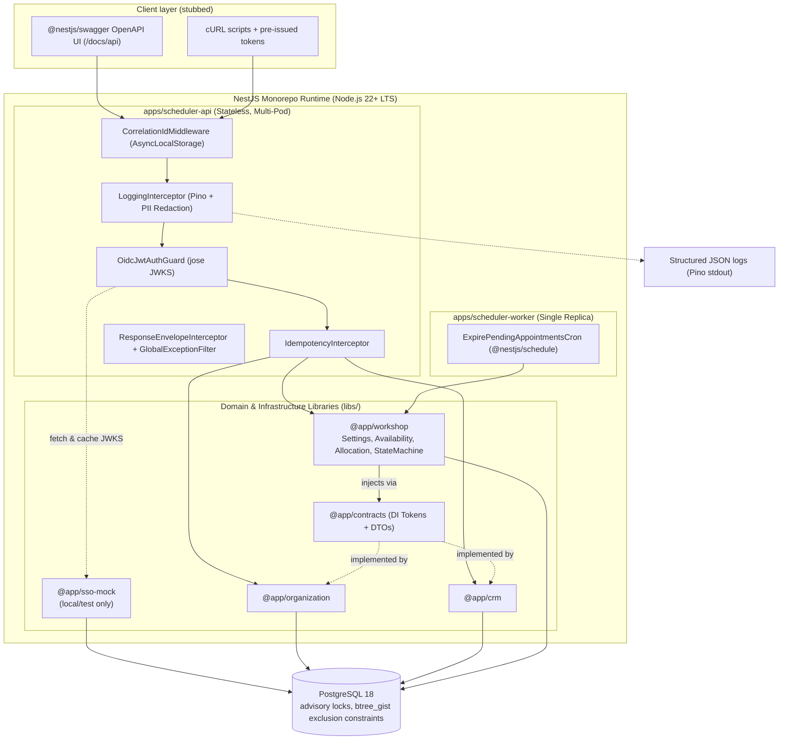
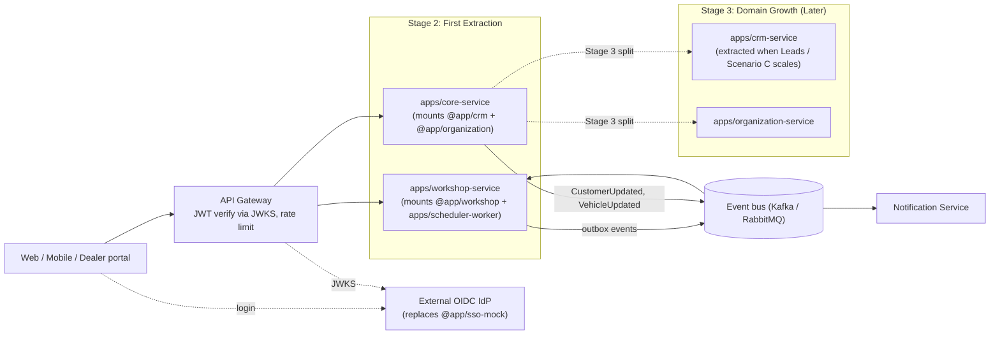
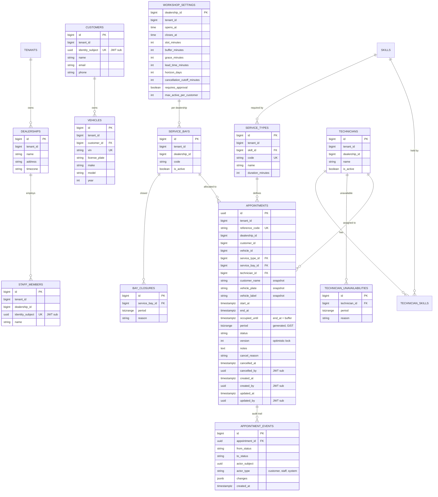
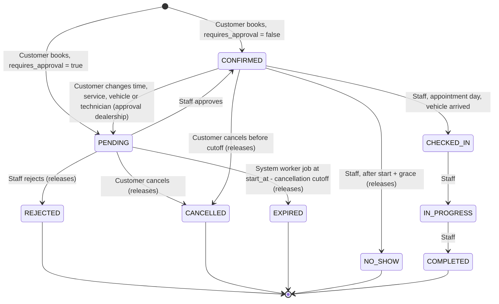
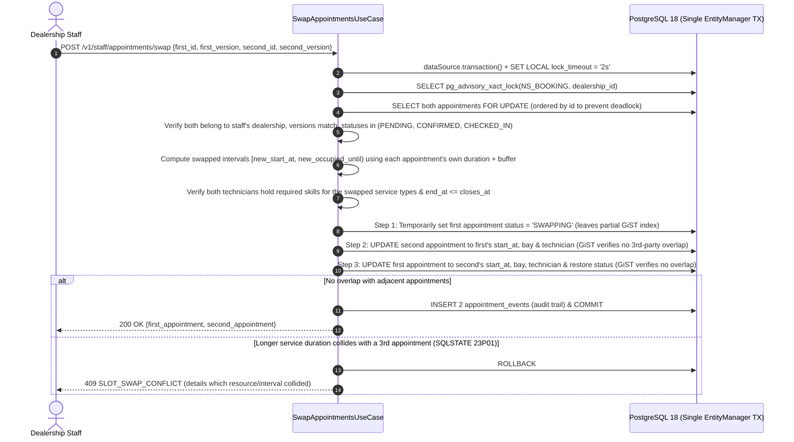

# System Design Document — The Unified Service Scheduler (Scenario A)

| Item | Value |
| :--- | :--- |
| Domain | Ownership — Service / Workshop |
| Implemented layer | **Backend** (RESTful API + persistent PostgreSQL). Client layer is stubbed via OpenAPI/Swagger UI, cURL and pre-issued tokens. |
| Stack | TypeScript 5+, Node.js 22+ LTS, **NestJS Monorepo (`apps/` + `libs/`)**, TypeORM, PostgreSQL 18, Pino, Docker Compose |
| Document status | v4 — NestJS Monorepo architecture |

---

## 1. Problem Statement & Scope

Dealerships currently book service appointments manually. The goal is a backend service that lets an **existing customer** book a service appointment for one of their vehicles at a chosen dealership and time, while guaranteeing in real time that **both** a free **Service Bay** and a free, **qualified Technician** are available for the whole service duration — and that a confirmed appointment record links customer, vehicle, technician and bay.

### 1.1 Actors

| Actor | Authenticates? | In scope (MVP) | Out of scope (documented only) |
| :--- | :--- | :--- | :--- |
| **Customer** (already has an account and registered vehicles) | Yes — SSO token | List own vehicles, browse dealerships & service types, query availability, optionally pick a technician, create / edit / cancel appointments, view history | Self sign-up, guest booking, nearest-dealership recommendation |
| **Dealership Staff** | Yes — SSO token (bound to one dealership) | List appointments of **their own dealership**, approve / reject, reassign technician / bay, **swap two appointments' slots**, check-in, start, complete, mark no-show | Managing bays, technicians, shifts; multi-dealership admin |
| **Technician** | No — a schedulable resource | Auto-assigned (best-fit) or chosen by customer / staff | Technician app |
| **Service Bay** | No — a schedulable resource | Auto-assigned or chosen by staff | Bay management UI |
| **System** | — | Scheduled worker job expiring unapproved `PENDING` appointments | — |

### 1.2 Delivery priorities

| Priority | Content |
| :--- | :--- |
| **P0 — core requirements** | Availability query, serialized booking with bay + qualified technician allocation, confirmed appointment record (auto-confirm), token authentication, concurrent HTTP booking tests |
| **P1 — build for the future** | Approval flow (`requires_approval`), staff scope by dealership, reassignment, **atomic slot swap**, lifecycle state machine, PENDING expiry worker job, active-appointment limit, idempotency, optimistic locking, response envelope, structured Pino logging with masking & `@LogSpan()` decorator, minimal mock OIDC, OpenAPI/Swagger docs, module-boundary lint rules |
| **P2 — design only** | Overrun re-allocation, automatic no-show, transactional outbox + event bus (Kafka / RabbitMQ), Row-Level Security, waitlist, shift / closure management APIs, real SSO, physical microservice split |

---

## 2. Assumptions

### 2.1 Scope & actors
| # | Assumption |
| :--- | :--- |
| S1 | Only customers who already own an account and registered vehicles use the system. Sign-up and customer management are out of scope (seeded data). |
| S2 | The customer explicitly chooses the dealership. No location-based recommendation. |
| S3 | Every dealership can service every vehicle make/model. |
| S4 | Staff belong to exactly one dealership and can only see and act on that dealership's appointments. |
| S5 | Single tenant for now, but every business table carries `tenant_id` (one default tenant). |

### 2.2 Resources
| # | Assumption |
| :--- | :--- |
| R1 | Each dealership has a fixed pool of **10 service bays and 10 technicians** (seeded, no CRUD). |
| R2 | One vehicle is handled by exactly **one technician in one bay** for the whole appointment. |
| R3 | A technician works on one vehicle at a time; a bay holds one vehicle at a time. |
| R4 | Each `ServiceType` requires one `Skill`; a technician may hold several skills. |
| R5 | When the customer does not pick a technician, the scheduler uses **best-fit**: the qualified, free technician with the **fewest skills**, then the lowest load that day — so versatile technicians stay available for specialist work. Bays: lowest load that day. |
| R6 | Technician shifts / leave and bay closures are **not managed** in the MVP. Tables `technician_unavailabilities` and `bay_closures` exist (empty by default) and are already excluded in availability and allocation queries, so adding the data later requires no code change. |

### 2.3 Booking rules & Slot-Grid Alignment (per-dealership `workshop_settings`)
| # | Assumption | Default |
| :--- | :--- | :--- |
| B1 | **Mandatory Default Service Duration:** Every `ServiceType` defines a fixed standard labor time `duration_minutes` applied immediately when selected (`end_at = start_at + service_type.duration_minutes`). Customers do not supply custom durations. | — |
| B2 | **Turnover Buffer:** Resources are occupied during `[start_at, end_at + buffer)` (`occupied_until = end_at + buffer_minutes`) to absorb small overruns and bay preparation. | `buffer_minutes = 15` |
| B3 | **Slot-Grid Alignment (Zero Fragmentation Rule):** To eliminate dead time between appointments on the `slot_minutes` (`30 min`) grid while keeping the `15 min` buffer separate, `ServiceType` durations are standardized so that **`(duration_minutes + buffer_minutes)` is an exact multiple of `slot_minutes` (`30 min`)**. Thus `occupied_until` always lands squarely on the next valid `start_at` boundary (0% slot fragmentation). | `(duration + 15) % 30 == 0` |
| B4 | Half-open intervals `[start, end)` — back-to-back bookings (`08:00–09:00` occupied followed by `09:00` start) do not conflict. | — |
| B5 | Start times align to the slot grid inside workshop hours (dealership timezone). **`end_at ≤ closes_at`**; the buffer may extend past closing time. | `slot = 30`, `08:00–18:00` |
| B6 | Booking window: `start_at ≥ now + lead_time` and `start_at ≤ now + horizon`. | `120 min`, `30 days` |
| B7 | A vehicle cannot have two overlapping active appointments anywhere. | — |
| B8 | A customer can hold at most N active appointments (prevents one customer from monopolising capacity). | `max_active_per_customer = 3` |
| B9 | `requires_approval = false` → appointment is **`CONFIRMED` immediately**; `true` → **`PENDING`** until staff approves. In both cases resources are **reserved at booking time**. | Seed: dealership A `false`, dealership B `true` |

#### Seeded Service Catalog (Aligned to 30-Minute Grid with 15-Minute Buffer)

| Code | Service Type Name | Required Skill | `duration_minutes` | `+ buffer_minutes` | Total Occupied (`occupied_until - start_at`) | Grid Slots (`30m`) |
| :--- | :--- | :--- | :--- | :--- | :--- | :--- |
| `OIL_CHANGE` | Express Oil & Filter Service | `GENERAL_MAINTENANCE` | **45 min** | + 15 min | **60 min** | 2 slots |
| `BRAKE_SERVICE` | Brake Pad & Rotor Inspection / Service | `BRAKE_SPECIALIST` | **75 min** | + 15 min | **90 min** | 3 slots |
| `EV_DIAGNOSTIC` | EV High-Voltage Battery & Motor Diagnostic | `EV_HIGH_VOLTAGE` | **105 min** | + 15 min | **120 min** | 4 slots |
| `MAJOR_SERVICE` | Comprehensive Annual Major Service | `GENERAL_MAINTENANCE` | **165 min** | + 15 min | **180 min** | 6 slots |

### 2.4 Lifecycle rules
| # | Assumption |
| :--- | :--- |
| L1 | **Customer edits** (`PENDING` / `CONFIRMED`, until `start_at − cancellation_cutoff`): `start_at`, `service_type_id`, `vehicle_id` (own vehicle), `technician_id` (must be qualified and free), `notes`. The current bay / technician are kept if still free for the new interval, otherwise re-allocated. |
| L2 | At a `requires_approval` dealership, a customer change to time, service type, vehicle or technician returns a `CONFIRMED` appointment to `PENDING`; a notes-only change keeps the status. At auto-confirm dealerships the status stays `CONFIRMED`. |
| L3 | **Staff reassignment** (`PENDING` / `CONFIRMED` / `CHECKED_IN`): staff may set a specific technician and / or bay if qualified and free; status is unchanged. |
| L4 | **Cancellation** by the customer until `start_at − cancellation_cutoff` (default 120 min) is a **soft cancel** (`CANCELLED`, `cancelled_at`, `cancelled_by`, `cancel_reason`). Resources are released immediately because only active statuses occupy resources. |
| L5 | **PENDING expiry (system job):** a `PENDING` appointment still not approved when `now ≥ start_at − cancellation_cutoff` becomes `EXPIRED` and releases its resources. This is the only automatic transition. |
| L6 | Operational transitions (`CHECKED_IN → IN_PROGRESS → COMPLETED`, `NO_SHOW`) are **manual, staff-only, and only on the appointment day**. `NO_SHOW` is allowed only after `start_at + grace` (default 15 min). Future-dated appointments can only be edited, reassigned, swapped or cancelled. |
| L7 | **Early Completion:** When staff mark an `IN_PROGRESS` appointment as `COMPLETED` ahead of `end_at`, its status leaves the occupying set immediately — releasing both its `ServiceBay` and `Technician` for the remainder of the scheduled window while keeping the planned `start_at / end_at` intact for SLA comparison. |
| L8 | **Early Arrival & Slot Swap (3-Scenario Operational Rule):** If Customer 2 (booked at `10:00–11:00` with `Technician 1`) arrives at `08:00` while Customer 1's `08:00–09:00` booking on `Technician 1` / `Bay 1` has not yet arrived:<br/>1. **Scenario A — Move up using other free resources (before grace period expires):** Customer 1's `08:00–09:00` slot cannot be taken while within `grace_minutes`. Customer 2 can only be moved to `08:00–09:00` if **BOTH** another qualified `Technician` **AND** another free `ServiceBay` are available at `08:00–09:00` (preventing bay exhaustion).<br/>2. **Scenario B — After Grace Period (`08:15`):** Once `now ≥ start_at + grace_minutes` without Customer 1 arriving, staff mark Customer 1 `NO_SHOW` (releasing `Bay 1` and `Technician 1`) and move Customer 2 into the `08:00` slot.<br/>3. **Scenario C — Atomic Slot Swap (`POST /v1/staff/appointments/swap`):** If Customer 1 informs the dealership they will arrive late at `10:00` and agrees to trade slots, staff execute an atomic swap between the two appointments (validating skill compatibility, duration fit without colliding with adjacent bookings, and bay/technician availability). |
| L9 | Statuses that occupy resources: `PENDING, CONFIRMED, CHECKED_IN, IN_PROGRESS`. |

---

## 3. Domain Decomposition — DMS-aligned NestJS Monorepo (`apps/` + `libs/`)

The system is structured as a **NestJS Monorepo** separating **physical deployment entry points (`apps/`)** from **logical domain bounded contexts (`libs/`)** aligned with a **Dealer Management System (DMS)**:

```text
source/
├── apps/
│   ├── scheduler-api/          # Stateless HTTP REST API server (controllers, Swagger bootstrap)
│   └── scheduler-worker/       # Single-replica background cronjob worker (PENDING expiry job)
└── libs/
    ├── common/                 # (@app/common) Shared kernel: ALS context, Pino logger, @LogSpan(),
    │                           # ResponseEnvelopeInterceptor, GlobalExceptionFilter, OidcJwtAuthGuard,
    │                           # IdempotencyInterceptor, AuditColumnsSubscriber
    ├── contracts/              # (@app/contracts) Public DI interface tokens & cross-module DTOs
    ├── workshop/               # (@app/workshop) Core bounded context: Settings, ServiceCatalog,
    │                           # Resource (Bays, Technicians, Skills), Appointment, StateMachine
    ├── crm/                    # (@app/crm) Customer & Vehicle lifecycle domain
    ├── organization/           # (@app/organization) Tenant, Dealership directory & Staff domain
    └── sso-mock/               # (@app/sso-mock) Minimal Mock OIDC Provider (local/test only)
```

| Monorepo Package | Nature & Boundary | Owns |
| :--- | :--- | :--- |
| **`@app/workshop`** (`libs/workshop`) | **Core business bounded context (Ownership domain)** — highest write load and concurrency | Skills, service types, service bays, technicians, unavailabilities, **workshop settings**, appointments, availability, allocation, lifecycle |
| **`@app/crm`** (`libs/crm`) | **Customer & Asset lifecycle domain (PII / GDPR boundary)** — high data growth; expands into Lead Management (Demand domain / Scenario C) and ownership history | Customers, vehicles, ownership |
| **`@app/organization`** (`libs/organization`) | **Organizational & Tenant directory (Platform foundation)** — low rate of change, small dataset, shared across domains | Tenants, dealerships (identity, address, timezone), staff |
| **`@app/sso-mock`** (`libs/sso-mock`) | Infrastructure stand-in for an external IdP | OAuth clients, login identities, RSA signing keys (mounted only when `SSO_MOCK_ENABLED=true`) |
| **`@app/contracts` & `@app/common`** | Shared contracts & infrastructure kernel | Cross-module interfaces/DTOs, JWT verification, `AsyncLocalStorage` context, Pino logging, response envelope, idempotency, audit subscriber |

> **Key design decisions:**
> 1. **Single-transaction booking hot path:** Bays, technicians, booking rules (`workshop_settings`) and appointments all live in `@app/workshop`. The booking hot path — *serialize per dealership → pick bay + technician → insert appointment* — stays inside **one library, one database, one ACID transaction**, with zero runtime dependency on `@app/organization`.
> 2. **Why `@app/crm` and `@app/organization` are NOT merged into a "Master Data" library:** In an automotive DMS, Customer/Vehicle data (high-growth PII & asset lifecycle) and Tenant/Dealership structure (low-churn organizational directory) have fundamentally different rates of change, compliance rules, and domain evolutions. Keeping them as distinct libraries in `libs/` prevents a "God Master Data" anti-pattern while costing zero runtime overhead.
> 3. **Dedicated `apps/scheduler-worker` for Cron Safety:** Separating scheduled jobs (`@Cron`) into `apps/scheduler-worker` (deployed as a single replica and guarded by `pg_try_advisory_xact_lock`) allows `apps/scheduler-api` to scale horizontally to N pods without triggering duplicate cron executions.

### 3.1 Module boundaries — enforced in CI
1. **Public contracts in `@app/contracts`.** Cross-domain communication goes strictly through TypeScript interfaces and injection tokens exported by `@app/contracts` (e.g. `CRM_DIRECTORY_CONTRACT` providing `findVehicleOwnedByCustomer()`, `getVehiclesByIds()` returning `VehicleDto`). In the modular monolith, `CrmModule` binds `CRM_DIRECTORY_CONTRACT` to an in-process service; when extracted to a microservice, only the DI provider binding changes to an HTTP/cached adapter — `@app/workshop` code does not change.
2. **Module boundary lint rules in CI (`eslint-plugin-boundaries` / `dependency-cruiser`):** `@app/workshop` is forbidden from importing internal entities, repositories, or services from `@app/crm` or `@app/organization` — it may only import from `@app/contracts` and `@app/common`. Any violation fails `npm run lint`.
3. **Foreign keys only inside a domain library.** Cross-domain references (`dealership_id`, `customer_id`, `vehicle_id`) are indexed plain columns validated through `@app/contracts`, so each library can move to its own database later without breaking constraints.
4. **Display snapshots instead of cross-module reads.** Appointments store `customer_name`, `vehicle_plate`, `vehicle_label` at booking / edit time, so staff lists need no N+1 calls to `@app/crm`, and history stays correct if a vehicle changes owner.

---

## 4. Architecture

### 4.1 Current implementation — NestJS Monorepo (`apps/` + `libs/`)



### 4.2 Evolution path — Phased Strangler Extraction (Logical Boundaries ≠ Physical Deployment Units)

Because the codebase is already organized into `apps/` (deployment entry points) and `libs/` (domain modules), extracting a microservice requires **creating a new `apps/<service>/src/main.ts` bootstrap file without moving domain code**:



1. **Stage 1 (MVP — Modular Monolith):** `apps/scheduler-api` mounts `@app/workshop`, `@app/crm`, and `@app/organization` in a single deployable container, while `apps/scheduler-worker` runs scheduled jobs.
2. **Stage 2 (First Extraction — `Workshop Service`):** When workshop scheduling load or team autonomy justifies independent deployment, **`Workshop Service` is extracted first** with its own database. Meanwhile, **`@app/crm` and `@app/organization` remain co-deployed in `apps/core-service`** — avoiding premature microservice fragmentation and unnecessary network hops for low-churn organizational data, while preserving clean internal module boundaries.
3. **Stage 3 (Domain Growth — `CRM Service` Extraction):** Only when the CRM domain expands into high-volume workflows (such as Scenario C — Sales Lead Management) is **`apps/crm-service` extracted** into its own physical service, leaving `@app/organization` as a lightweight tenant/directory foundation.
4. **Event-driven integration:** `@app/workshop` reaches external modules through `@app/contracts` (rebound from in-process providers to HTTP/cached adapters), relies on display snapshots for read views, and publishes domain events (`AppointmentCreated`, `AppointmentConfirmed`, `AppointmentCancelled`, …) via a **Transactional Outbox**.

---

## 5. Data Model



- **Audit columns:** `created_by`, `updated_by`, `cancelled_by` hold the JWT `sub` of the acting customer or staff member; `NULL` for system actions (the matching `appointment_events` row records `actor_type = system`). Automatically populated via a reusable TypeORM `AuditColumnsSubscriber` reading `actorSub` from `AsyncLocalStorage`.
- Supporting tables: `idempotency_keys (subject, key, request_hash, status, response, expires_at)` with `UNIQUE(subject, key)`; mock SSO tables `sso_clients`, `sso_users`. `outbox_events` is P2.

### 5.1 Integrity constraints (PostgreSQL)

```sql
CREATE EXTENSION IF NOT EXISTS btree_gist;

-- period = [start_at, occupied_until)
ALTER TABLE appointments ADD COLUMN period tstzrange
  GENERATED ALWAYS AS (tstzrange(start_at, occupied_until, '[)')) STORED;

ALTER TABLE appointments ADD CONSTRAINT no_bay_overlap EXCLUDE USING gist
  (service_bay_id WITH =, period WITH &&)
  WHERE (status IN ('PENDING','CONFIRMED','CHECKED_IN','IN_PROGRESS'));

ALTER TABLE appointments ADD CONSTRAINT no_technician_overlap EXCLUDE USING gist
  (technician_id WITH =, period WITH &&)
  WHERE (status IN ('PENDING','CONFIRMED','CHECKED_IN','IN_PROGRESS'));

ALTER TABLE appointments ADD CONSTRAINT no_vehicle_overlap EXCLUDE USING gist
  (vehicle_id WITH =, period WITH &&)
  WHERE (status IN ('PENDING','CONFIRMED','CHECKED_IN','IN_PROGRESS'));

CREATE INDEX appointments_dealership_start_idx ON appointments (dealership_id, start_at);
CREATE INDEX appointments_customer_status_idx  ON appointments (customer_id, status);
CREATE INDEX appointments_pending_expiry_idx   ON appointments (start_at) WHERE status = 'PENDING';
```

The exclusion constraints make double-booking **impossible at the storage level**, independent of application code; they are the last line of defence behind the per-dealership advisory lock (§8).

### 5.2 Why range + GiST rather than a discrete slot table
| Criterion | Range + GiST (chosen) | Slot table (one row per 30 min) |
| :--- | :--- | :--- |
| Double-booking guarantee | Exclusion constraint | Unique constraint |
| Arbitrary durations / buffers / unavailability windows | Yes | Must be slot multiples |
| Rows per appointment | 1 | N |
| Day availability query | One SQL with `generate_series` | Simple count |

---

## 6. Appointment Lifecycle



Edits, staff reassignments, and slot swaps that keep the status are not drawn. All transitions are validated by a single `AppointmentStateMachine` (actor type + current status + time rules + `requires_approval`), and every change writes an `appointment_events` row.

---

## 7. Data Flows

### 7.1 Availability — `GET /v1/dealerships/{id}/availability?date=&service_type_id=`
**One parameterized SQL statement** computes every slot of the day:
1. `generate_series` produces candidate start times on the slot grid within workshop hours (respecting `end_at ≤ closes_at`, lead time and horizon).
2. For each candidate interval `[start, start + duration + buffer)`, count active bays with no overlapping active appointment and no closure, and active technicians holding the required skill with no overlapping active appointment and no unavailability.
3. Return `free_bays`, `free_technicians`, `remaining_capacity = min(…)` per slot.

`GET /v1/dealerships/{id}/technicians?service_type_id=&start_at=` returns the qualified technicians free for that interval (display name only), so a customer or staff member can pick one.

### 7.2 Booking — `POST /v1/appointments` (header `Idempotency-Key`)

```mermaid
sequenceDiagram
    autonumber
    actor C as Customer
    participant MW as NestJS Guards & Interceptors
    participant UC as CreateAppointmentUseCase
    participant CRM as CRM_DIRECTORY_CONTRACT
    participant DB as PostgreSQL (Single EntityManager TX)

    C->>MW: POST /v1/appointments {dealership_id, vehicle_id, service_type_id, start_at, technician_id?}
    MW->>MW: CorrelationId (AsyncLocalStorage), REQUEST_START log, OidcJwtAuthGuard
    MW->>DB: INSERT idempotency_keys (IN_PROGRESS) - unique (subject, key)
    MW->>UC: validated DTO + ActorContext
    UC->>CRM: findVehicleOwnedByCustomer() (returns snapshot data)
    UC->>UC: compute end_at, occupied_until; validate hours, lead time, horizon
    UC->>DB: dataSource.transaction(async (manager) => { ... })
    UC->>DB: manager.query("SET LOCAL lock_timeout = '2s'; SET LOCAL statement_timeout = '5s'")
    UC->>DB: manager.query("SELECT pg_advisory_xact_lock($1, $2)", [NS_BOOKING, dealershipId])
    UC->>DB: check active-appointment limit, vehicle overlap (via manager)
    UC->>DB: pick free bay + best-fit qualified technician (or requested technician) (via manager)
    alt bay and technician found
        UC->>DB: manager.insert(Appointment) + manager.insert(AppointmentEvent)
        UC->>DB: COMMIT (releases advisory lock)
        UC-->>C: 201 {statusCode, errorCode: null, data: appointment}
    else no capacity
        UC->>DB: ROLLBACK
        UC-->>C: 409 SLOT_UNAVAILABLE + up to 3 alternatives
    end
    MW->>DB: UPDATE idempotency_keys (COMPLETED, response)
    MW->>MW: REQUEST_END log (full response, duration_ms)
```

> **Critical Node.js / TypeORM Connection-Pool Rule:** Because Node.js `pg` uses a connection pool, calling `this.repository.find()` outside the transaction's `EntityManager` would borrow a *different* connection from the pool that does not hold `pg_advisory_xact_lock` or `SET LOCAL lock_timeout`. Every query inside `CreateAppointmentUseCase`, `UpdateAppointmentUseCase`, `ReassignAppointmentUseCase`, and `SwapAppointmentsUseCase` **must execute exclusively through the transactional `manager: EntityManager`** passed by `dataSource.transaction()`.

### 7.3 Staff transition — `POST /v1/staff/appointments/{id}/approve` (header `If-Match: <version>`)
1. `OidcJwtAuthGuard` + `@Roles('staff')` verify `actor_type = staff`; repository queries enforce `dealership_id = actor.dealershipId` (other dealerships' appointments return 404).
2. `AppointmentStateMachine` checks the transition and its time rule.
3. `UPDATE … SET status = $1, version = version + 1, updated_by = $2 WHERE id = $3 AND version = $4` — 0 affected rows → `409 VERSION_CONFLICT`.
4. Insert `appointment_events` row; respond with the new representation and version.

### 7.4 Customer edit / staff reassignment
Inside `dataSource.transaction(async (manager) => { ... })`: acquire the dealership advisory lock, lock the appointment row (`FOR UPDATE`), verify `version`, then:
- keep the current bay / technician if still free for the new interval, else re-allocate (best-fit), or validate the explicitly requested technician / bay (`409 TECHNICIAN_UNAVAILABLE` / `BAY_UNAVAILABLE` if not free; in Scenario A early arrival move-up, verify **both** a free bay and a free qualified technician exist);
- refresh snapshots when the vehicle changes;
- apply L2 (back to `PENDING` at approval dealerships) for customer changes; staff reassignment keeps the status.

### 7.5 PENDING expiry — `ExpirePendingAppointmentsCron` (`apps/scheduler-worker`, every 5 minutes)
Runs in the single-replica `apps/scheduler-worker` process, acquires `pg_try_advisory_xact_lock(NS_CRON_EXPIRE)` for safety, selects `PENDING` appointments where `now ≥ start_at − cancellation_cutoff` (index `appointments_pending_expiry_idx`), sets `EXPIRED` with optimistic-lock semantics, and writes `appointment_events` with `actor_type = system`.

### 7.6 Atomic Slot Swap — `POST /v1/staff/appointments/swap`
When an early-arriving customer (`Appointment B`, e.g. `10:00–11:00`) and a delayed customer (`Appointment A`, e.g. `08:00–09:00`) agree to exchange slots at the same dealership, `SwapAppointmentsUseCase` executes the swap atomically inside a single `dataSource.transaction()`:



> **Why the 3-step `SWAPPING` update?** PostgreSQL does not allow `DEFERRABLE` on *partial* exclusion constraints (`WHERE status IN (...)`). Temporarily setting the first row's status to `'SWAPPING'` inside the serialized transaction removes it from the partial GiST index while the second row moves into its slot, and restoring its active status at the new slot triggers full GiST validation against all other appointments before `COMMIT`. Uncommitted states are never visible outside the transaction.

---

## 8. Concurrency & Reliability

| Risk | Mechanism |
| :--- | :--- |
| Two requests race for the same resources | **`pg_advisory_xact_lock(NS_BOOKING, dealership_id)`** executed on the transactional `EntityManager` as the first statement of every booking / edit / reassignment / swap transaction: allocation within one dealership is serialized. After acquiring the lock, each statement (`READ COMMITTED`) sees all previously committed bookings, so the bay / technician choice is always accurate. With 10 bays per dealership the serialized section is a few milliseconds. Different dealerships never block each other. |
| Why not `FOR UPDATE SKIP LOCKED` on bay / technician rows | Row locks are not time-scoped: a 09:00 booking holding bay #1 would make a concurrent 14:00 booking skip bay #1 although it is free at 14:00 → **false `409`**. Rejected after design review. |
| Node.js connection-pool interleaving | Every query in a transactional use case runs on the single `EntityManager` instance provided by `dataSource.transaction()`, guaranteeing that `SET LOCAL`, `pg_advisory_xact_lock`, reads, and writes share one physical connection. |
| Application bug / unforeseen path | Exclusion constraints reject any overlap (`23P01`). Vehicle overlap across two dealerships (different locks) is caught here and mapped to `409 VEHICLE_ALREADY_BOOKED`. |
| Lock waits | `SET LOCAL lock_timeout = '2s'`, `statement_timeout = '5s'`; on lock timeout (`55P03`) or deadlock (`40P01`) retry up to 2 times with exponential backoff + jitter, then `503`. |
| Double submit / client retry | `Idempotency-Key` required on `POST /v1/appointments`. The key row is **inserted first** (`status = IN_PROGRESS`, committed) under `UNIQUE(subject, key)`; a concurrent duplicate gets `409 IDEMPOTENCY_IN_PROGRESS`; a later duplicate with the same body replays the stored response; same key with a different body → `422 IDEMPOTENCY_KEY_REUSED`. On 5xx the row is deleted so the client can retry. Keys expire after 24 h. |
| Concurrent edit / status change on one appointment | Optimistic locking: `version` exposed as `ETag`; mutating requests require `If-Match`; stale → `409 VERSION_CONFLICT`. |
| Capacity monopolised / slots held forever | `max_active_per_customer` (`409 ACTIVE_APPOINTMENT_LIMIT_REACHED`); PENDING expiry worker job; `@nestjs/throttler` rate limiting (`429 TOO_MANY_REQUESTS`). |
| No capacity | `409 SLOT_UNAVAILABLE` with `data.reason` (`NO_FREE_BAY` / `NO_QUALIFIED_TECHNICIAN`) and **0–3 alternative slots** from a bounded search (rest of the day, then up to 7 days, never beyond the horizon). Empty → `DEALERSHIP_FULLY_BOOKED`. |
| Overruns / late arrival / early arrival | Buffer absorbs small overruns; grace period before `NO_SHOW`; 3-scenario early arrival rule + atomic slot swap (`POST /v1/staff/appointments/swap`). Large-overrun downstream re-allocation is P2. |

**Scaling note:** if one dealership's booking rate ever makes the per-dealership lock a bottleneck, the lock key can be narrowed to `(dealership_id, local date)` (an edit or swap across days acquires both keys in ascending date order).

---

## 9. API Design

### 9.1 Unified response envelope

```json
{
  "statusCode": 409,
  "errorCode": "SLOT_UNAVAILABLE",
  "data": { "reason": "NO_QUALIFIED_TECHNICIAN", "alternatives": [] },
  "message": "Dealership is fully booked for the requested period",
  "meta": { "correlation_id": "6f1c…" }
}
```

| Key | Description |
| :--- | :--- |
| `statusCode` | HTTP status code (mirrors the transport status) |
| `errorCode` | `null` on success, otherwise a stable machine-readable code |
| `data` | Payload (object, list, or error details such as validation errors) |
| `message` | Human-readable message |
| `meta` | Pagination (`page`, `per_page`, `total`), `correlation_id`, other metadata |

Implemented once in `@app/common` via `ResponseEnvelopeInterceptor` (for 2xx responses) and `GlobalExceptionFilter` (for all `DomainException` and `HttpException` instances).

**Error codes:** `UNAUTHENTICATED`, `FORBIDDEN`, `NOT_FOUND`, `VALIDATION_FAILED`, `SLOT_UNAVAILABLE`, `DEALERSHIP_FULLY_BOOKED`, `TECHNICIAN_UNAVAILABLE`, `BAY_UNAVAILABLE`, `VEHICLE_ALREADY_BOOKED`, `SLOT_SWAP_CONFLICT`, `ACTIVE_APPOINTMENT_LIMIT_REACHED`, `INVALID_STATE_TRANSITION`, `VERSION_CONFLICT`, `PRECONDITION_REQUIRED`, `IDEMPOTENCY_IN_PROGRESS`, `IDEMPOTENCY_KEY_REUSED`, `TOO_MANY_REQUESTS`, `SERVICE_UNAVAILABLE`, `INTERNAL_ERROR`.

### 9.2 Endpoints

| Method | Path | Actor |
| :--- | :--- | :--- |
| GET | `/.well-known/openid-configuration`, `/oauth/jwks` | Public (mock SSO) |
| POST | `/oauth/token` | OAuth client (mock SSO) |
| GET | `/v1/me/vehicles` | Customer |
| GET | `/v1/dealerships`, `/v1/service-types` | Customer, Staff |
| GET | `/v1/dealerships/{id}/availability?date=&service_type_id=` | Customer |
| GET | `/v1/dealerships/{id}/technicians?service_type_id=&start_at=` | Customer |
| POST | `/v1/appointments` (`Idempotency-Key`) | Customer |
| GET | `/v1/appointments`, `/v1/appointments/{id}` | Customer (own only) |
| PATCH | `/v1/appointments/{id}` (`If-Match`) | Customer |
| POST | `/v1/appointments/{id}/cancel` (`If-Match`) | Customer |
| GET | `/v1/staff/appointments?date=&status=&page=` | Staff (own dealership) |
| POST | `/v1/staff/appointments/{id}/reassign` (`If-Match`) | Staff |
| POST | `/v1/staff/appointments/swap` | Staff (own dealership, optimistic versions in payload) |
| POST | `/v1/staff/appointments/{id}/{approve\|reject\|check-in\|start\|complete\|no-show}` (`If-Match`) | Staff |
| GET | `/health/live`, `/health/ready` | Infrastructure |

---

## 10. Security — Authentication via (Mock) OIDC SSO

Authentication is **fully delegated to an SSO identity provider**; the business API is a pure *resource server*. A **minimal mock OIDC provider** (`@app/sso-mock`) emulates the standard contract. There is **one SSO issuer for the whole system**; customers and staff sign in with email/password.

| Concern | MVP design |
| :--- | :--- |
| Client registration | `sso_clients`: `client_id`, hashed `client_secret`, audience (e.g. `scheduler-web` → `aud = scheduler-api`). |
| Signing keys | RSA key pair generated by `npm run sso:keys`; private key in `storage/sso` (git-ignored); public key published as JWKS with `kid`. |
| Discovery | `GET /.well-known/openid-configuration` (static JSON: `issuer`, `token_endpoint`, `jwks_uri`, algorithms). |
| Token endpoint | `POST /oauth/token` with `client_id`, `client_secret`, `grant_type = password`, `username`, `password` → `access_token` (JWT **RS256**, 15 min, signed via `jose`) with claims `iss, aud, sub, exp, iat, jti, actor_type, roles, tenant_id, dealership_id`. Password grant is a **mock convenience**; a real IdP would use Authorization Code + PKCE. |
| Verification (`OidcJwtAuthGuard` in `@app/common`) | Uses `jose` (`createRemoteJWKSet` / cached JWKS) to verify signature (strict `exp` check, zero clock leeway), `iss`, `aud`; populates `ActorContext` in `AsyncLocalStorage`. Never queries SSO tables. |
| Login bypass | `npm run sso:issue-token -- <email>`; the database seeder prints ready-to-use tokens for sample customers and staff (README / Swagger UI). |
| Deferred | Refresh-token rotation, `userinfo`, `client_credentials`. |
| Real IdP later | Disable the mock (`SSO_MOCK_ENABLED=false`); set `SSO_ISSUER`, `SSO_JWKS_URI`, `SSO_AUDIENCE`; custom claims via IdP claim mappers. No business code change. |
| Authorization | Guards + repository dealership scopes: customers see only their own appointments; staff only their dealership's; cross-dealership access returns 404. |

---

## 11. Observability

### 11.1 Structured logging (Pino JSON to stdout + `AsyncLocalStorage`)
- **`AsyncLocalStorage` Request Context (`node:async_hooks`):** Because Node.js processes concurrent requests on a single event loop, `CorrelationIdMiddleware` initializes an `AsyncLocalStorage` store containing `{ correlationId, actorSub, actorType, tenantId, dealershipId }` for each incoming request. Pino's `mixin` hook automatically injects `correlation_id` into **every log line** emitted during that request, and `correlation_id` is returned in `X-Correlation-ID` and `meta.correlation_id`.
- **Request boundary logs** written by `LoggingInterceptor` (using Pino's built-in ISO timestamp):
  - `event = REQUEST_START`: method, route, `user_id` (`sub`), `actor_type`, platform (`X-Client-Platform`), masked request payload.
  - `event = REQUEST_END`: HTTP status, `errorCode`, `duration_ms`, heap memory usage, **full response body for both success and error** (masked), exception (class, message, file, line, top stack frames) if any.
- **Zero-boilerplate Span logs via `@LogSpan()` TypeScript Decorator:** Decorating key UseCase / Service methods (`@LogSpan()`) automatically logs a minimal span entry (`class`, `function`, `input`, `output`) with the active `correlation_id` from `AsyncLocalStorage`.
- **Sensitive-data masking** (Pino redaction + custom serializer) applied to request, response and span payloads: `password`, `client_secret`, `access_token`, `authorization`, `email`, `phone`, VIN (partial), and snapshot fields such as `customer_name`.
- **Volume control:** `info` level in production; span logs can be sampled. Response logging is complete by default; an optional `LOG_RESPONSE_MAX_BYTES` env variable allows a cap per environment if storage cost requires it.

### 11.2 Metrics (Prometheus / OpenTelemetry-ready)
- RED metrics: `http_requests_total{route,status}`, `http_request_duration_seconds{route}`.
- Business: `booking_attempts_total{dealership, outcome=created|no_bay|no_technician|limit}`, `appointments_expired_total`, `appointment_transitions_total{to_status}`, `appointment_swaps_total`.
- Database: advisory lock wait time, lock timeouts, `pg` connection pool utilization.

### 11.3 Tracing & health
- Correlation ID now; W3C `traceparent` propagation and OpenTelemetry SDK export when services are extracted.
- `/health/live` (process up) and `/health/ready` (`@nestjs/terminus` checking PostgreSQL connection and JWKS / signing keys loaded).

---

## 12. Multi-tenancy Evolution

| Stage | Approach |
| :--- | :--- |
| Now | Single default tenant; `tenant_id` column on every business table; `tenant_id` claim in the token and `AsyncLocalStorage`. |
| Next | Repository base filter by `tenant_id` from `AsyncLocalStorage` + **PostgreSQL Row-Level Security** (`SET LOCAL app.tenant_id`) as defence in depth. Tenant = dealer group owning several dealerships. |
| Large tenants | Hybrid schema-per-tenant / database-per-tenant routed by tenant ID. |

---

## 13. Testing Strategy

| Layer | What | How |
| :--- | :--- | :--- |
| Unit | Interval / overlap rules, slot grid (`end_at ≤ closes_at`, buffer overflow, slot-grid alignment), state machine edges, best-fit ordering, PII log masking | **Jest**, pure TypeScript (no DB) |
| Integration / E2E | Every endpoint: success, validation, `409` reasons + alternatives, approval vs auto-confirm, edits (vehicle / technician / time), reassignment, **atomic slot swap**, expiry cron, idempotency, optimistic locking, cross-dealership isolation, rate limit | **Jest + Supertest** against real PostgreSQL |
| **Concurrency** | `Promise.all()` firing 20+ simultaneous HTTP requests against the live NestJS server: (1) same slot → `201` count ≤ capacity, zero overlapping bay/technician, rest get `409`; (2) **different** time slots concurrently → all succeed (regression test proving no false `409`) | Separate Jest concurrency spec using real pooled PostgreSQL connections (tables truncated between tests, **not** wrapped in a single rollback transaction) |
| Architecture | Module boundaries: `@app/workshop` may only import `@app/contracts` and `@app/common`, never internal files of `@app/crm` or `@app/organization` | **`eslint-plugin-boundaries`** in CI (`npm run lint`) |

---

## 14. Technology Choices

| Technology | Why | Trade-off |
| :--- | :--- | :--- |
| **Node.js 22+ LTS & TypeScript 5+** | Strict static typing for DTOs/Contracts, native `AsyncLocalStorage`, non-blocking I/O, effortless concurrency testing via `Promise.all`. | Event-loop requires `AsyncLocalStorage` for request context and strict `EntityManager` transaction pinning. |
| **NestJS Monorepo (`apps/` + `libs/`)** | Native separation between deployable units (`apps/scheduler-api`, `apps/scheduler-worker`) and domain libraries (`libs/*`); TypeScript decorators (`@LogSpan()`), Interceptors, Guards, and DI tokens map cleanly to DMS modules. | Slightly more initial TypeScript configuration (`tsconfig.json` paths, `nest-cli.json`). |
| **TypeORM + PostgreSQL 18** | Explicit `dataSource.transaction(manager => ...)` control for `pg_advisory_xact_lock`, `tstzrange` + `btree_gist` exclusion constraints, `EntitySubscriber` for audit columns. | Complex availability queries (`generate_series`) are written as parameterized SQL via `manager.query()`. |
| **Pino (`nestjs-pino`)** | Ultra-low-overhead structured JSON logger with built-in redaction and `AsyncLocalStorage` mixin support. | — |
| **Minimal mock OIDC (`jose`)** | Standards-compliant RS256 JWT signing and JWKS verification using Web Crypto APIs with zero native C++ dependencies. | Password grant only in the mock. |
| **Docker Compose** | One-command startup (`docker compose up -d`), environment parity (`ENV TZ=UTC` + `tzdata`). | — |
| **`@nestjs/swagger`** | Auto-generates OpenAPI 3.0 spec and interactive Swagger UI (`/docs/api`) directly from TypeScript DTOs. | — |

---

## 15. GenAI Collaboration in the Design Phase

Google Antigravity was used as a design partner; the design was also reviewed independently and refined through multi-agent architectural sessions. Key iterations:

| # | First proposal | Critique / correction | Outcome |
| :--- | :--- | :--- | :--- |
| 1 | AI design covered only the customer booking request. | I pointed out the implicit actors (staff, technicians, bays) and wrote my own assumptions. | Actor model, staff flow, explicit scope table. |
| 2 | — | AI flagged contradictions in my assumptions: approval-time allocation breaks the real-time requirement; "any technician" drops "qualified technician". | Reserve at booking time; minimal skill model. |
| 3 | Initial framework exploration. | Evaluated modular monolith boundaries vs physical microservices. | Modular monolith now; phased extraction path documented. |
| 4 | AI: separate Dealership / Scheduling services with a local projection. | I proposed DMS-aligned modules. | Bays, technicians, appointments in Workshop — one transaction, no projection. |
| 5 | AI: RFC 7807 errors. | Team-wide envelope `{statusCode, errorCode, data, message, meta}`. | `ResponseEnvelopeInterceptor` + `GlobalExceptionFilter` in `@app/common`. |
| 6 | AI: framework-coupled auth. | I required full SSO delegation with an OIDC client_id / client_secret / public-key contract. | Mock OIDC (`@app/sso-mock`) + `jose` JWKS verification. |
| 7 | My initial choice: hard delete. | AI showed soft cancel frees the slot and keeps audit history. | Soft cancel. |
| 8 | AI: verbose logging with extra fields, response bodies only on errors. | I required start/end markers, framework timestamps, minimal spans, correlation ID on every line, and **full responses for success and error**. | `LoggingInterceptor` + Pino + `AsyncLocalStorage` + `@LogSpan()` decorator. |
| 9 | AI: `FOR UPDATE SKIP LOCKED` on bay / technician rows. | **Design review** showed row locks are not time-scoped → false `409` under load. | Per-dealership advisory lock + exclusion constraints; dedicated regression test. |
| 10 | Booking rules on `dealerships`; cross-module reads; approval always required; PENDING could hold slots forever; "any technician". | Review + my decisions. | `workshop_settings` in `@app/workshop`, display snapshots, `@app/contracts` + boundary lint rules, `requires_approval` (auto-confirm default), expiry worker job + active limit, best-fit technician, `end_at ≤ closing`, idempotency race fix. |
| 11 | Vehicle not editable; technician only system-assigned. | I required customers and staff to be able to change vehicle / technician when free, plus full audit columns. | Edit / reassign flows, snapshot refresh, `created_by / updated_by / cancelled_by` via TypeORM subscriber. |
| 12 | Review suggested merging CRM and Organization into a single "Master Data Service". | With the Architect agent, we evaluated DMS domain boundaries: merging Customer/Vehicle (high-growth PII & asset lifecycle) with Tenant/Dealership (low-churn org directory) in code creates a "God Master Data" anti-pattern. | Kept `@app/crm` and `@app/organization` logically separate in `libs/`, while co-deploying them in `apps/core-service` during Stage 2 extraction. |
| 13 | Arbitrary `duration_minutes` on `ServiceType` + `15 min` buffer (e.g. `60 + 15 = 75 min`). | In multi-agent discussion (Business Analyst + Architect), we identified that non-grid-aligned occupied durations create **slot fragmentation (dead time)** on a 30-minute grid. | Enforced **Slot-Grid Alignment** (`(duration_minutes + buffer_minutes) % slot_minutes == 0`) so every booking aligns with the 30-minute grid. |
| 14 | Early completion & early customer arrival (e.g. Customer 2 booked at `10:00` arrives at `08:00` while Customer 1 booked at `08:00` has not yet arrived). | I asked how to handle early completion, early arrival, and slot swapping without causing domino conflicts or overlooking bay exhaustion when switching technicians. | Designed a 3-scenario operational rule (checking **both** Bay and Technician in Scenario A) and `POST /v1/staff/appointments/swap` with a 3-step `SWAPPING` transition inside the dealership advisory lock. |
| 15 | Switching stack from PHP Laravel (Apiato) to **NestJS Monorepo (`apps/` + `libs/`)**. | Evaluated Node.js event-loop & connection-pool differences when migrating the design to NestJS. | Introduced `AsyncLocalStorage` for request/audit context isolation, strict transactional `EntityManager` connection pinning for `pg_advisory_xact_lock`, `@LogSpan()` decorator, and a dedicated single-replica `apps/scheduler-worker` for cron jobs. |
