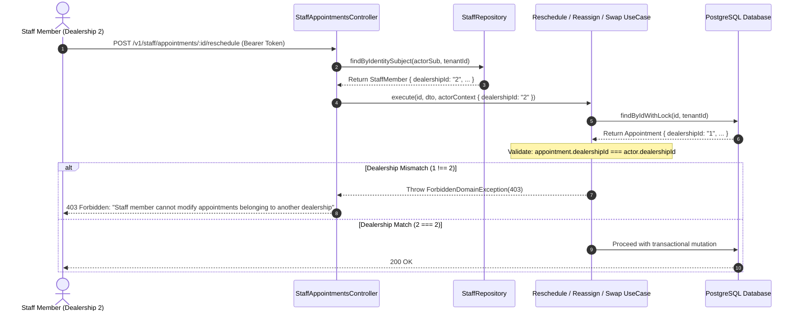

# Technical Specification: Dealership Isolation & Schedule Mutation Invariants

- **Document ID:** `TECH-SPEC-20261104-01`
- **Domain:** Workshop Service Scheduler — Enterprise Governance & Concurrency
- **Status:** APPROVED FOR IMPLEMENTATION 🚀
- **Authors:** Winston (System Architect), Amelia (Senior Dev Lead), Quinn (QA Lead)
- **Applicable Services:** `@app/workshop`, `@app/organization`, `apps/scheduler-api`

---

## 1. Executive Summary & Problem Definition

Trong hệ thống quản lý lịch bảo dưỡng xưởng dịch vụ đa đại lý (Multi-Dealership DMS), tính độc lập về dữ liệu giữa các đại lý và tính toàn vẹn thời gian của dây chuyền xưởng là các bất biến kiến trúc cốt lõi. Tài liệu này đặc tả chi tiết 4 quy chuẩn kỹ thuật bắt buộc:

1. **Dealership Boundary Isolation (Nguyên lý Cô lập Chi nhánh):** Nhân viên thuộc đại lý A (`dealership_id = A`) tuyệt đối không được phép xem hoặc chỉnh sửa lịch hẹn thuộc đại lý B (`dealership_id = B`).
2. **Temporal Immutability Guardrail (Bảo vệ Tính Bất biến Thời gian):** Chặn mọi thao tác điều phối đối với các lịch hẹn đã nằm trong quá khứ (`start_at <= NOW()`), và chặn dời lịch hẹn (`reschedule`) về một thời điểm trong quá khứ.
3. **Pre-Service State Machine Precondition:** Thao tác hoán đổi (`swap`), đổi thợ/khoang (`reassign`), và dời lịch (`reschedule`) chỉ được phép thực hiện khi lịch hẹn ở trạng thái **`PENDING`** hoặc **`CONFIRMED`**. Tuyệt đối không can thiệp khi xe đã tiếp nhận vào xưởng (`CHECKED_IN`, `IN_PROGRESS`) hoặc đã kết thúc (`COMPLETED`, `CANCELLED`, `NO_SHOW`, `EXPIRED`).
4. **Reschedule Reason Audit Contract:** Mở rộng DTO của API Reschedule với trường `reason` để đảm bảo lưu vết nguyên nhân thay đổi lịch phục vụ kiểm toán xưởng dịch vụ.

---

## 2. Architecture & Security Isolation Design

### 2.1. Dealership Scoping Flow



### 2.2. ActorContext Interface Enhancement

Trong file `libs/workshop/src/appointment/types/actor-context.interface.ts`:

```typescript
export interface ActorContext {
  actorSub: string;
  actorType: 'customer' | 'staff' | 'system';
  tenantId: string;
  dealershipId?: string; // Resolved from StaffMember for staff actors
  roles?: string[];
}
```

---

## 3. Detailed Domain Invariants & Rules

### 3.1. Temporal Boundaries (Bảo vệ Thời gian)

Mọi thao tác thay đổi lịch (`reassign`, `reschedule`, `swap`) đều phải kiểm tra:

1. **Lịch hẹn hiện tại không được ở trong quá khứ:**
   $$\text{start\_at} > \text{NOW()}$$
   Nếu $\text{start\_at} \le \text{NOW()}$, từ chối với mã lỗi `400 Bad Request`:
   ```json
   {
     "statusCode": 400,
     "errorCode": "VALIDATION_FAILED",
     "message": "Cannot modify an appointment that is already in the past"
   }
   ```
2. **Thời gian dời lịch mới (`targetStartAt`) phải ở tương lai:**
   $$\text{new\_start\_at} > \text{NOW()}$$
   Nếu $\text{new\_start\_at} \le \text{NOW()}$, từ chối với mã lỗi `400 Bad Request`:
   ```json
   {
     "statusCode": 400,
     "errorCode": "VALIDATION_FAILED",
     "message": "New appointment start time cannot be in the past"
   }
   ```

---

### 3.2. State Machine Preconditions (Ràng buộc Trạng thái)

Bảng ma trận cho phép thực hiện thao tác theo trạng thái:

| Trạng thái Hiện tại | Cho phép `reassign`? | Cho phép `reschedule`? | Cho phép `swap`? | Ghi chú |
| :--- | :---: | :---: | :---: | :--- |
| **`PENDING`** | ✅ Cho phép | ✅ Cho phép | ✅ Cho phép | Chưa duyệt, vẫn có thể điều phối lại slot/thợ |
| **`CONFIRMED`** | ✅ Cho phép | ✅ Cho phép | ✅ Cho phép | Đã xác nhận, xe chưa đến xưởng |
| **`CHECKED_IN`** | ❌ Chặn (409) | ❌ Chặn (409) | ❌ Chặn (409) | Xe đã ở bàn tiếp nhận, chuẩn bị vào khoang |
| **`IN_PROGRESS`** | ❌ Chặn (409) | ❌ Chặn (409) | ❌ Chặn (409) | Xe đang ở trên cầu nâng sửa chữa |
| **`COMPLETED`** | ❌ Chặn (409) | ❌ Chặn (409) | ❌ Chặn (409) | Dịch vụ đã hoàn tất |
| **`CANCELLED`** | ❌ Chặn (409) | ❌ Chặn (409) | ❌ Chặn (409) | Lịch đã hủy |
| **`NO_SHOW`** | ❌ Chặn (409) | ❌ Chặn (409) | ❌ Chặn (409) | Khách không đến |
| **`EXPIRED`** | ❌ Chặn (409) | ❌ Chặn (409) | ❌ Chặn (409) | Lịch pending đã hết hạn |

Khi vi phạm trạng thái, quăng `InvalidStateTransitionException` (HTTP `409 Conflict`):
```json
{
  "statusCode": 409,
  "errorCode": "INVALID_STATUS_TRANSITION",
  "message": "Appointment can only be modified when status is PENDING or CONFIRMED (current: CHECKED_IN)"
}
```

---

### 3.3. API Contract Update — Reschedule DTO

Cập nhật `RescheduleAppointmentDto`:

```typescript
export class RescheduleAppointmentDto {
  @ApiPropertyOptional({
    name: 'start_at',
    description: 'New scheduled start time ISO 8601 UTC (snake_case in request)',
    example: '2026-11-10T03:00:00.000Z',
  })
  @IsOptional()
  @Trim()
  @IsString()
  public startAt?: string;

  @ApiPropertyOptional({
    name: 'technician_id',
    description: 'Optional re-assigned technician identifier',
    example: '2',
  })
  @IsOptional()
  @IsString()
  @Trim()
  public technicianId?: string;

  @ApiPropertyOptional({
    description: 'Reason for reschedule or early arrival (stored in audit log)',
    example: 'Customer requested early morning shift due to urgent travel',
  })
  @IsOptional()
  @IsString()
  @Trim()
  public reason?: string;

  @ApiPropertyOptional({
    description: 'Additional staff operational notes',
    example: 'Customer arrived early at workshop reception',
  })
  @IsOptional()
  @IsString()
  @Trim()
  public notes?: string;

  @ApiPropertyOptional({
    description: 'Optimistic lock version expected in database',
    example: 1,
  })
  @IsOptional()
  @Type(() => Number)
  @IsInt()
  @Min(1)
  public version?: number;
}
```

---

## 4. Implementation Checklist for Developer (Amelia)

- [ ] **Step 1:** Thêm `reason?: string` vào `RescheduleAppointmentDto` và cập nhật OpenAPI descriptions.
- [ ] **Step 2:** Thêm `dealershipId?: string` vào `ActorContext`.
- [ ] **Step 3:** Trong `StaffAppointmentsController`, inject `StaffRepository` để tra cứu `dealershipId` theo `actorSub`.
- [ ] **Step 4:** Cập nhật `TransitionAppointmentStatusUseCase`: validate `appointment.dealershipId === actor.dealershipId`.
- [ ] **Step 5:** Cập nhật `ReassignAppointmentUseCase`:
  - Check `dealershipId` matching.
  - Check `startAt > NOW()`.
  - Check `status in [PENDING, CONFIRMED]`.
- [ ] **Step 6:** Cập nhật `RescheduleAppointmentUseCase`:
  - Check `dealershipId` matching.
  - Check `appointment.startAt > NOW()` và `newStartAt > NOW()`.
  - Check `status in [PENDING, CONFIRMED]`.
  - Ghi nhận `dto.reason` vào `changes` payload của `appointment_events`.
- [ ] **Step 7:** Cập nhật `SwapAppointmentsUseCase`:
  - Check cả 2 appointments thuộc `actor.dealershipId`.
  - Check cả 2 appointments có `startAt > NOW()`.
  - Check cả 2 appointments có `status in [PENDING, CONFIRMED]`.
- [ ] **Step 8:** Chạy Unit test suite và kiểm thử hồi quy.
