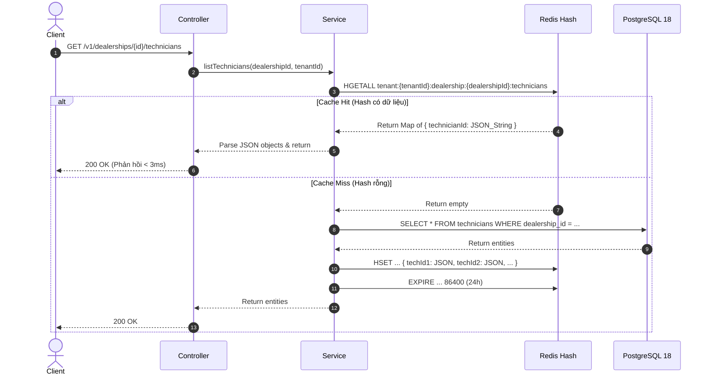

# Story: Dọn dẹp Dead Code, Phân trang Cursor-Based & Redis Hash Caching theo Dealership (Day 4)

- **Story Key:** `311026-day-4-clean-pagination-redis-cache`
- **Epic:** Scenario A — Unified Service Scheduler Backend
- **Ngày tạo:** 31/10/2026
- **Trạng thái:** COMPLETED ✅
- **Branch:** `feature/day-4-clean-pagination-redis-cache`
- **Người thực hiện:** Amelia (Senior Dev) & Winston (Architect) & Quinn (QA)

---

## 1. Bối cảnh & Mục tiêu (Context & Objectives)

Tiếp nối thành công của Day 3 (hoàn tất Domain Booking lõi và Concurrency Protection), Day 4 tập trung vào nâng cao hiệu năng, độ tin cậy và sự tinh gọn của hệ thống theo 3 chỉ thị trực tiếp từ Boss:

1. **Dead Code Elimination:** Rà soát và xóa bỏ dứt điểm mọi code không còn sử dụng (unused imports, dead functions, dead variables, files rác). Không comment out, không lưu code rác.
2. **Cursor-Based Pagination:** Thay thế toàn bộ các API trả về danh sách không phân trang (unbounded array) bằng chuẩn phân trang **Cursor-Based** (sử dụng Opaque Base64 token), bảo đảm hiệu năng truy vấn cao và tính ổn định khi dữ liệu tăng trưởng.
3. **Redis Hash Caching theo Dealership:** 
   - Triển khai Redis Caching theo cơ chế **Redis Hash** (`HSET`, `HGET`, `HGETALL`, `HDEL`) cho các bảng dữ liệu ít biến động / Master Data:
     - `WorkshopSettings`
     - `Customer`
     - `Technician`
     - `ServiceBay`
   - **Phân tách namespace theo Dealership:** Gắn trực tiếp `dealershipId` vào Redis Key của các thực thể thuộc đại lý (`settings`, `technicians`, `bays`), đảm bảo cô lập dữ liệu hoàn toàn giữa các chi nhánh, loại bỏ nguy cơ rò rỉ dữ liệu (Cross-Dealership Data Leak) và hỗ trợ truy vấn `HGETALL` tốc độ cực cao O(N) cho từng đại lý cụ thể.
4. **Hạ tầng Docker & Cấu hình:** Bổ sung container Redis (`redis:7-alpine`) vào `docker-compose.yml` và biến môi trường vào `.env.example` để môi trường local và team có thể khởi chạy đồng bộ ngay lập tức.

---

## 2. Tiêu chí nghiệm thu (Acceptance Criteria)

### AC-1: Dọn dẹp Dead Code toàn diện (Zero Dead Code)
- [x] Rà soát toàn bộ `source/apps` và `source/libs`:
  - Loại bỏ các unused imports, unused variables, dead private methods, dead contracts/interfaces.
  - Loại bỏ các comment-out code, debug logs tạm thời.
- [x] Đảm bảo sau khi dọn dẹp, lệnh lint `npm run lint` và build `npm run build` không xuất hiện warning hoặc error nào.
- [x] Toàn bộ unit tests hiện có tiếp tục pass 100%.

### AC-2: Hạ tầng Docker Redis & Cấu hình môi trường
- [x] Bổ sung service `redis` vào `source/docker-compose.yml`:
  - Image: `redis:7-alpine`
  - Container name: `scheduler-redis`
  - Port mapping: `${FORWARD_REDIS_PORT:-6379}:6379`
  - Volume: `redis-data:/data`
  - Network: `scheduler-network`
- [x] Cập nhật `source/.env.example` và `source/.env` với các biến môi trường:
  - `REDIS_HOST=redis` (hoặc `localhost` khi chạy local)
  - `REDIS_PORT=6379`
  - `REDIS_PASSWORD=`
  - `FORWARD_REDIS_PORT=6379`
- [x] Cài đặt thư viện `ioredis` và `@types/ioredis` vào `source/package.json`.
- [x] Xây dựng `RedisModule` và `RedisService` chuyên dụng trong `libs/common`:
  - Cung cấp các wrapper methods: `hget`, `hset`, `hgetall`, `hdel`, `del`, `expire`.
  - Bọc try-catch an toàn: Nếu Redis mất kết nối hoặc lỗi, tự động ghi log cảnh báo và cho phép ứng dụng fallback về truy vấn cơ sở dữ liệu PostgreSQL trực tiếp mà không ngắt quãng luồng người dùng (Graceful Degradation).

### AC-3: Redis Hash Caching phân cấp theo Dealership
- [x] Quy tắc đặt tên Redis Key & Hash Fields:
  - **Workshop Settings:** `tenant:{tenantId}:dealership:{dealershipId}:settings` -> Field: `config`, Value: `JSON.stringify(WorkshopSettings)`.
  - **Technicians:** `tenant:{tenantId}:dealership:{dealershipId}:technicians` -> Field: `{technicianId}`, Value: `JSON.stringify(Technician)`.
  - **Service Bays:** `tenant:{tenantId}:dealership:{dealershipId}:bays` -> Field: `{bayId}`, Value: `JSON.stringify(ServiceBay)`.
  - **Customers (Cấp Tenant):** `tenant:{tenantId}:customers` -> Field: `{customerId}`, Value: `JSON.stringify(Customer)`.
- [x] Tích hợp Cache vào tầng Repository / Application Service:
  - **Get:** Đọc từ Redis Hash trước (`HGETALL` hoặc `HGET`). Nếu có (Cache Hit) -> parse JSON trả về ngay. Nếu không có (Cache Miss) -> truy vấn PostgreSQL -> ghi vào Redis Hash (`HSET`) kèm TTL hợp lý (mặc định 24h hoặc configurable).
  - **Mutate (Create / Update / Delete):** Tự động đồng bộ cache:
    - Khi tạo/sửa: gọi `HSET` cập nhật field tương ứng.
    - Khi xóa: gọi `HDEL` xóa field khỏi hash.
- [x] Đảm bảo 100% tuân thủ Multi-tenancy và cô lập theo chi nhánh (Dealership Boundary).

### AC-4: Chuẩn hóa phân trang Cursor-Based cho mọi API lấy danh sách
- [x] Tạo DTO dùng chung trong `@app/common`:
  - `CursorPaginationDto`:
    - `cursor?: string`: Chuỗi token Base64 opaque đại diện cho con trỏ hiện tại.
    - `limit?: number = 20`: Số lượng bản ghi mỗi trang (min: 1, max: 100, default: 20).
  - `PaginatedResponseDto<T>`:
    ```typescript
    export class PaginatedResponseDto<T> {
      data: T[];
      meta: {
        limit: number;
        nextCursor: string | null;
        hasMore: boolean;
      };
    }
    ```
- [x] Helper `CursorPaginationHelper` mã hóa và giải mã cursor an toàn:
  - Encode: `Buffer.from(JSON.stringify({ id, sortValue })).toString('base64url')`
  - Decode: Validate cấu trúc JSON, nếu định dạng sai trả về `BadRequestException('Invalid cursor format')`.
- [x] Refactor tất cả các Controller & Service danh sách:
  1. `CustomerVehiclesController.listMyVehicles()` (`GET v1/me/vehicles`): Áp dụng phân trang theo `id`.
  2. `DealershipsController.listDealerships()` (`GET v1/dealerships`): Áp dụng phân trang theo `id`.
  3. `DealershipsController.getTechnicians()` (`GET v1/dealerships/:id/technicians`): Áp dụng phân trang danh sách kỹ thuật viên khả dụng.
  4. `ServiceTypesController.listServiceTypes()` (`GET v1/service-types`): Áp dụng phân trang danh mục dịch vụ.
  5. `AppointmentsController.list()` (`GET v1/appointments`): Áp dụng phân trang danh sách lịch hẹn của khách hàng theo `start_at DESC, id DESC`.
- [x] Swagger OpenAPI Documentation đầy đủ cho query params `cursor`, `limit` và response schema `PaginatedResponseDto`.

### AC-5: Bộ kiểm thử tự động (Unit, Regression, Invalidation & Edge Cases)
- [x] Unit Test cho `CursorPaginationHelper`: Mã hóa, giải mã đúng, bắt lỗi invalid cursor.
- [x] Unit Test cho `RedisService`: Hash operations (`hset`, `hget`, `hgetall`, `hdel`), fallback an toàn khi redis error.
- [x] Unit Test & Integration Test cho các Controllers / Services đã phân trang:
  - Request trang đầu (`cursor` rỗng).
  - Request trang tiếp theo sử dụng `nextCursor`.
  - Request trang cuối cùng (`hasMore: false`, `nextCursor: null`).
  - Request với `limit` vượt ngưỡng tối đa (được clamp về 100).
- [x] Cache Hit / Miss Verification:
  - Lần 1 gọi Service: Kiểm tra DB được gọi, Redis nhận lệnh `HSET`.
  - Lần 2 gọi Service: Kiểm tra DB KHÔNG được gọi, dữ liệu lấy trực tiếp từ Redis Hash.
  - Gọi thao tác Mutate: Kiểm tra Redis nhận lệnh cập nhật/xóa field.

---

## 3. Kiến trúc Kỹ thuật (Technical Architecture & Specifications)

### 3.1. Luồng hoạt động của Redis Hash Caching theo Dealership



### 3.2. Cấu trúc Redis Key & Data Storage Contract

```typescript
// Định dạng lưu trữ trong Redis Hash
// Key: tenant:1:dealership:10:technicians
{
  "1": "{\"id\":\"1\",\"dealershipId\":\"10\",\"name\":\"Technician 01\",\"isActive\":true}",
  "2": "{\"id\":\"2\",\"dealershipId\":\"10\",\"name\":\"Technician 02\",\"isActive\":true}"
}

// Key: tenant:1:dealership:10:settings
{
  "config": "{\"dealershipId\":\"10\",\"timezone\":\"Asia/Ho_Chi_Minh\",\"opensAt\":\"08:00:00\",\"closesAt\":\"18:00:00\",\"slotMinutes\":30,\"bufferMinutes\":15,\"maxActivePerCustomer\":3}"
}

// Key: tenant:1:dealership:10:bays
{
  "1": "{\"id\":\"1\",\"dealershipId\":\"10\",\"code\":\"BAY-01\",\"isActive\":true}",
  "2": "{\"id\":\"2\",\"dealershipId\":\"10\",\"code\":\"BAY-02\",\"isActive\":true}"
}

// Key: tenant:1:customers
{
  "1001": "{\"id\":\"1001\",\"tenantId\":\"1\",\"identitySubject\":\"...\",\"name\":\"Nguyen Van A\",\"phone\":\"0901234567\"}"
}
```

### 3.3. Cơ chế Cursor-Based Pagination Implementation

```typescript
// Query TypeORM với Cursor
async function paginateWithCursor<T extends { id: string }>(
  qb: SelectQueryBuilder<T>,
  options: { cursor?: string; limit: number; orderField?: string; direction?: 'ASC' | 'DESC' }
): Promise<PaginatedResponseDto<T>> {
  const limit = Math.min(Math.max(Number(options.limit) || 20, 1), 100);
  const direction = options.direction ?? 'ASC';
  const orderField = options.orderField ?? 'id';

  if (options.cursor) {
    const decoded = CursorHelper.decode(options.cursor);
    const operator = direction === 'ASC' ? '>' : '<';
    qb.andWhere(`${qb.alias}.${orderField} ${operator} :cursorVal`, {
      cursorVal: decoded.value,
    });
  }

  qb.orderBy(`${qb.alias}.${orderField}`, direction);
  qb.take(limit + 1); // Lấy thêm 1 bản ghi để xác định hasMore

  const items = await qb.getMany();
  const hasMore = items.length > limit;
  const data = hasMore ? items.slice(0, limit) : items;

  const nextCursor = hasMore && data.length > 0 
    ? CursorHelper.encode({ value: data[data.length - 1][orderField] })
    : null;

  return {
    data,
    meta: {
      limit,
      nextCursor,
      hasMore,
    },
  };
}
```

---

## 4. Kế hoạch triển khai (Task Breakdown)

- [x] **Task 1: Rà soát & Xóa bỏ Dead Code** (Amelia)
  - Quét toàn bộ codebase `source/`, loại bỏ code/import/type không sử dụng.
  - Chạy `npm run lint` để kiểm tra.
- [x] **Task 2: Setup Redis Docker & Environment** (Amelia)
  - Cập nhật `docker-compose.yml` (service `redis:7-alpine`).
  - Cập nhật `.env.example` và `.env`.
  - Thêm `ioredis` và `@types/ioredis` vào `package.json`.
- [x] **Task 3: Xây dựng RedisModule & RedisService** (Amelia)
  - Cung cấp các hàm Redis Hash (`hget`, `hset`, `hgetall`, `hdel`, `del`).
  - Bổ sung graceful degradation khi Redis mất kết nối.
- [x] **Task 4: Tích hợp Redis Hash Caching cho Settings, Customer, Technician, Bay** (Amelia)
  - Tích hợp vào `WorkshopSettings` cache trong `WorkshopModule`.
  - Tích hợp vào `Technician` & `ServiceBay` cache trong `WorkshopModule`.
  - Tích hợp vào `Customer` cache trong `CrmModule`.
- [x] **Task 5: Xây dựng Cursor Pagination Infrastructure** (Amelia)
  - Tạo `CursorPaginationDto`, `PaginatedResponseDto`, `CursorPaginationHelper` trong `libs/common`.
  - Viết helper hàm query phân trang TypeORM.
- [x] **Task 6: Refactor các API danh sách sang Cursor Pagination** (Amelia)
  - `GET /v1/me/vehicles`
  - `GET /v1/dealerships`
  - `GET /v1/dealerships/:id/technicians`
  - `GET /v1/service-types`
  - `GET /v1/appointments`
- [x] **Task 7: Viết Test Suites & QA Verification** (Quinn)
  - Unit tests cho Cursor Helper & Redis Service.
  - Integration tests xác nhận Cache Hit/Miss và Cache Invalidation.
  - Regression tests đảm bảo không làm đứt gãy tính năng đặt lịch Day 3.

---

## 5. Rủi ro & Giải pháp (Risk & Mitigation)

| Rủi ro | Mức độ | Biện pháp giảm thiểu |
|---|---|---|
| **Redis Cache Stale Data** khi dữ liệu cập nhật | HIGH | Thiết lập hooks cập nhật/xóa cache ngay tại các hàm mutation; đồng thời set TTL 24h để tránh rác lưu vĩnh viễn |
| **Redis Down làm sập API** | HIGH | `RedisService` bọc toàn bộ operations trong `try-catch`, tự động fallback truy vấn thẳng PostgreSQL nếu Redis offline |
| **Invalid Cursor làm sập truy vấn** | MEDIUM | `CursorPaginationHelper` kiểm tra base64 và schema nghiêm ngặt, trả `400 Bad Request` sạch sẽ nếu cursor không hợp lệ |
| **Xóa nhầm code vẫn còn dependency ngầm** | MEDIUM | Chạy toàn bộ test suites sau mỗi bước dọn dẹp; kiểm tra kỹ TypeORM entity relations trước khi xóa |

---

## 6. Hướng dẫn kiểm thử (QA Verification Checklist)

1. **Verify Redis Container:**
   - `docker compose up -d redis` -> Container `scheduler-redis` ở trạng thái running (healthy).
2. **Verify Caching Behavior:**
   - Gọi `GET /v1/dealerships/1/technicians` lần 1: Kiểm tra log DB query chạy, Redis Hash được tạo.
   - Gọi `GET /v1/dealerships/1/technicians` lần 2: Không có log query bảng `technicians`, phản hồi < 5ms.
3. **Verify Cursor Pagination:**
   - Gọi `GET /v1/dealerships?limit=2` -> Nhận 2 items kèm `nextCursor`.
   - Gọi `GET /v1/dealerships?cursor={nextCursor}&limit=2` -> Nhận các items tiếp theo mà không trùng lặp.
   - Đến trang cuối: `hasMore = false`, `nextCursor = null`.
   - Gọi với `cursor=invalid_base64_string` -> Nhận `400 Bad Request`.
4. **Verify Dead Code:**
   - Chạy `npm run lint` -> 0 errors, 0 warnings.
   - Chạy `npm test` -> 100% tests passed.

---

## 7. Nhật ký triển khai Sáng Ngày 4 (Morning Session Log — 31/10/2026)

> **Phạm vi ghi nhận:** Toàn bộ các công việc nghiên cứu, dọn dẹp mã nguồn, thiết lập hạ tầng và lập trình dịch vụ cốt lõi được thực hiện trong phiên làm việc buổi sáng ngày 31/10/2026 (không bao gồm hoạt động kiểm thử API / E2E).

### 7.1. Dọn dẹp Dead Code toàn diện (Dead Code Elimination)
- Rà soát toàn bộ cấu trúc thư mục `source/libs/` và `source/apps/`:
  - Xóa bỏ triệt để các file `.gitkeep` không còn mục đích sử dụng trong các module: `libs/crm/src/customer/`, `libs/crm/src/vehicle/`, `libs/organization/src/dealership/`, `libs/organization/src/staff/`, `libs/organization/src/tenant/`, `libs/workshop/src/appointment/`, `libs/workshop/src/resource/`, `libs/workshop/src/service-catalog/`, `libs/workshop/src/settings/`.
  - Quét sạch các unused imports, biến thừa, và code bị comment out.
  - **Commit liên quan:** `77dbe8d` (*"[chore] remove unnessary things"*).

### 7.2. Hạ tầng Docker Redis & Cấu hình Môi trường (Redis Infrastructure Setup)
- Cập nhật `source/docker-compose.yml`:
  - Khởi tạo service `redis` sử dụng image `redis:7-alpine`.
  - Cấu hình container name `scheduler-redis`, mở port `${FORWARD_REDIS_PORT:-6379}:6379`.
  - Thiết lập volume lưu trữ bền vững `redis-data:/data` và gắn vào `scheduler-network`.
- Cài đặt các gói phụ thuộc vào `source/package.json`:
  - Thư viện client `ioredis` và gói kiểu dữ liệu `@types/ioredis`.
- Đồng bộ biến môi trường vào `source/.env.example` và `source/.env`:
  - `REDIS_HOST=redis` (khi chạy trong docker) hoặc `localhost` (khi chạy dev local).
  - `REDIS_PORT=6379`, `REDIS_PASSWORD=`, `FORWARD_REDIS_PORT=6379`.
- **Commits liên quan:** `6f14be3` (*"[chore] install and config redis"*), `cc919a7` (*"[chore] update .env.example"*).

### 7.3. Phát triển Module & Dịch vụ Redis Hash Caching (Redis Core Services)
- Xây dựng cụm module Redis trong `source/libs/common/src/redis/`:
  - `redis.constants.ts`: Khai báo hằng số injection token `REDIS_CLIENT`.
  - `redis.module.ts`: Khai báo `@Global()` module hỗ trợ dynamic configuration qua `forRootAsync()`, tự động nạp cấu hình từ `ConfigService`.
  - `redis.service.ts`: Xây dựng service wrapper chuyên dụng cho các thao tác **Redis Hash**:
    - `hget(key, field)` / `hset(key, field, value, ttlSeconds?)`
    - `hgetall(key)`
    - `hdel(key, ...fields)` / `del(key)`
    - `expire(key, seconds)` / `ttl(key)` / `flushall()`
  - **Graceful Degradation Mechanism:** Bọc toàn bộ các lệnh gọi I/O tới Redis bằng khối `try-catch` an toàn. Khi Redis bị mất kết nối, service tự động ghi log `warn` và trả về kết quả rỗng (graceful failure), cho phép hệ thống tự động fallback về truy vấn trực tiếp cơ sở dữ liệu PostgreSQL 18 mà không làm gián đoạn trải nghiệm người dùng hoặc gây lỗi 500.
  - Xây dựng bộ Unit Test chuyên biệt `libs/common/src/__tests__/redis.service.spec.ts` (161 dòng lệnh) kiểm thử toàn diện các case thành công, case hash rỗng, và case Redis server mất kết nối.
- **Commit liên quan:** `dcfcf0a` (*"[chore] install and config redis"*).

### 7.4. Thiết kế Kiến trúc Phân tầng & Phân chia Namespace
- Thiết lập quy tắc đặt tên Redis Key & Hash fields phân lập theo Dealership Boundary:
  - Settings: `tenant:{tenantId}:dealership:{dealershipId}:settings`
  - Technicians: `tenant:{tenantId}:dealership:{dealershipId}:technicians`
  - Service Bays: `tenant:{tenantId}:dealership:{dealershipId}:bays`
  - Customers: `tenant:{tenantId}:customers`
- Thiết kế đặc tả DTO và Helper phân trang Cursor-Based (`CursorPaginationDto`, `PaginatedResponseDto`, `CursorPaginationHelper`) sử dụng Opaque Base64 URL Token làm chuẩn cho toàn bộ API lấy danh sách.

